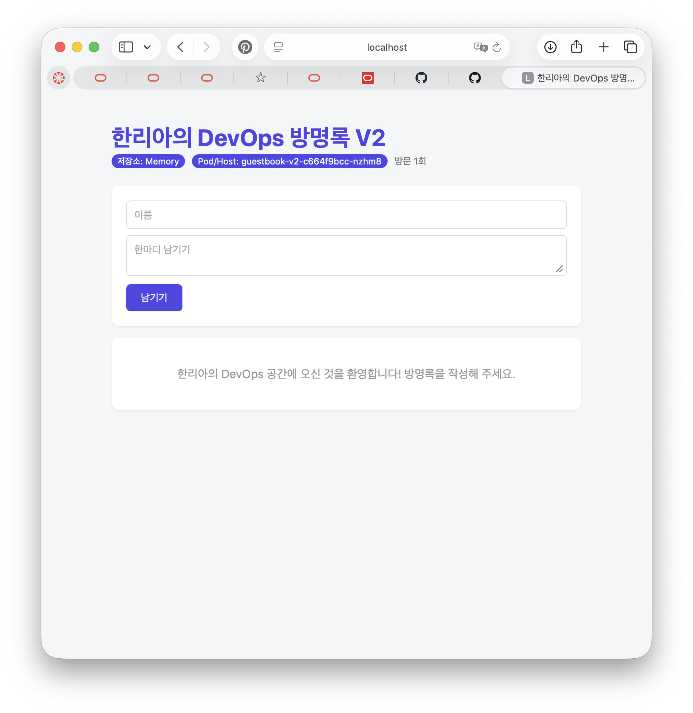

# 9주차 — 쿠버네티스

## 클러스터 노드

`kubectl get nodes` 명령으로 확인했고, `minikube` 노드가 `Ready` 상태인 것을 확인했습니다.

## 자동 복구

3개의 Pod를 가진 Deployment를 만들었습니다. Pod 하나를 삭제하자 쿠버네티스가 새 Pod를 생성해 3개를 유지하는 것을 확인했습니다.

## 방명록

`ghcr.io/infin1tum/guestbook:v2` 이미지를 `guestbook-v2` Deployment로 실행했습니다.
`kubectl port-forward`로 연결해 브라우저에서 방명록이 열린 것을 확인했습니다.

