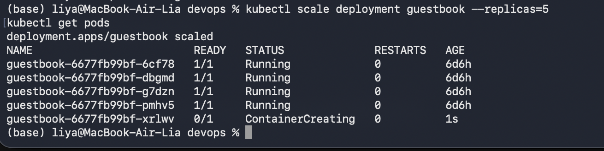
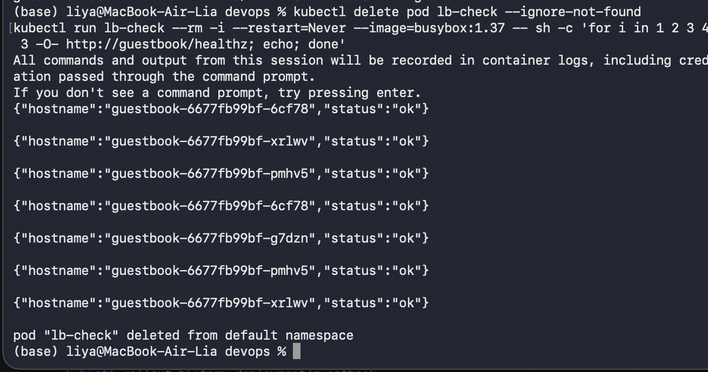
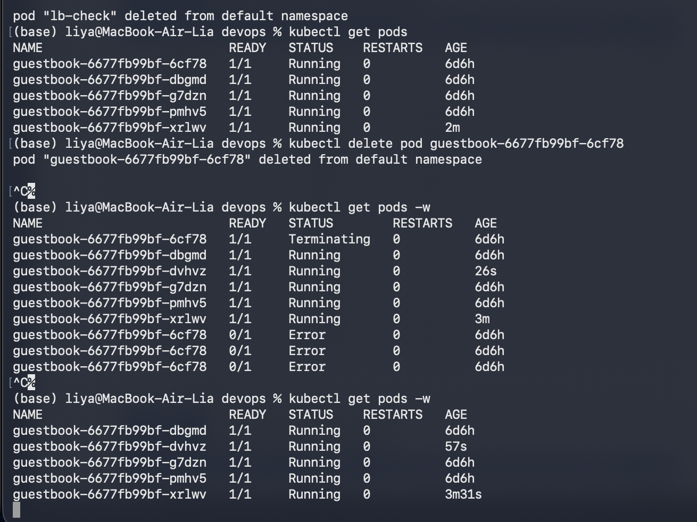
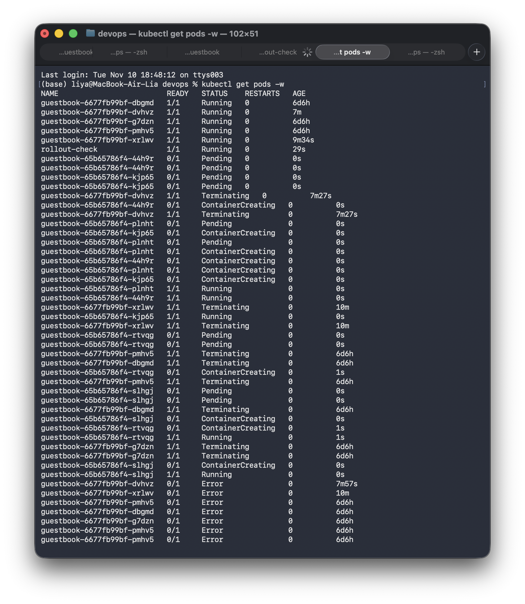
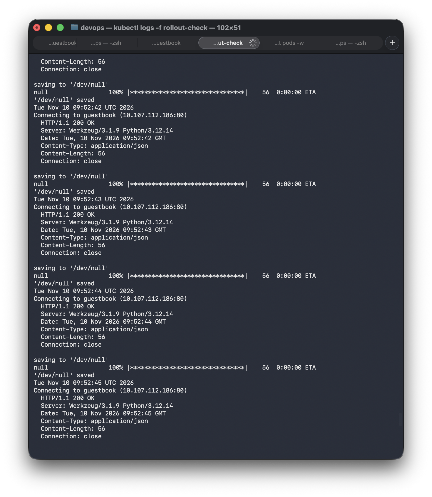
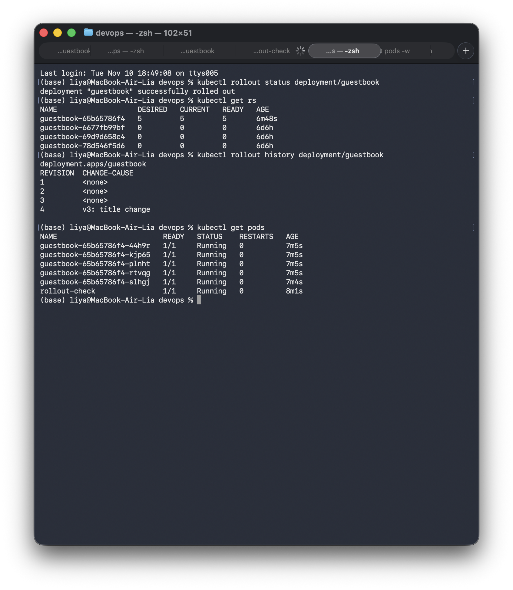
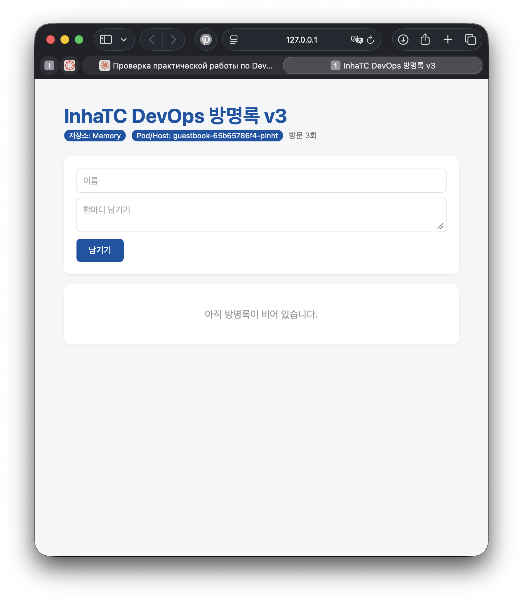
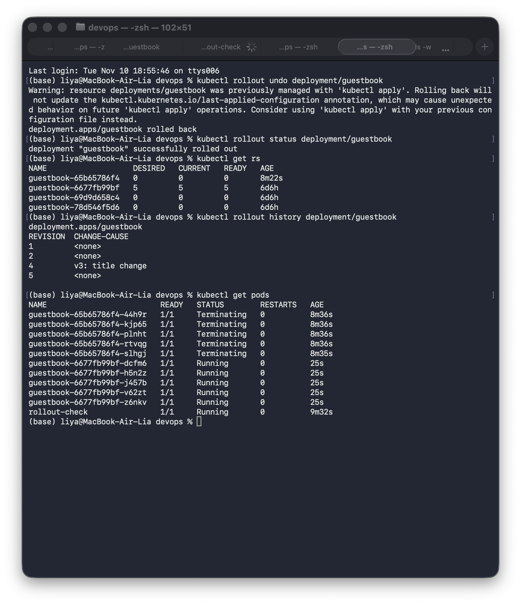
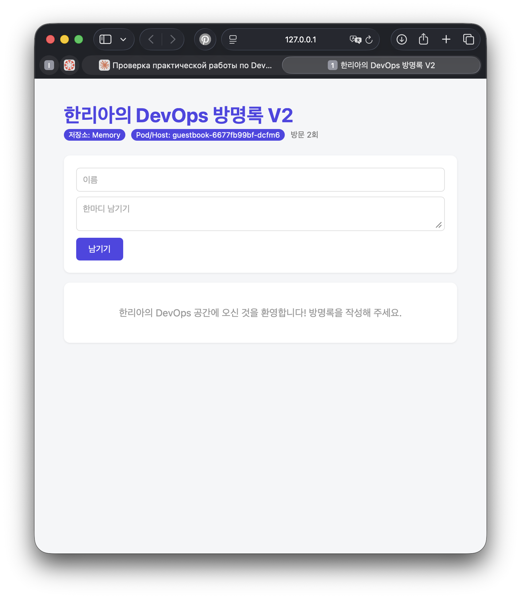

# 10주차 — 쿠버네티스 배포와 서비스

## 1. replicas=5 스케일링
`kubectl scale deployment guestbook --replicas=5`로 Pod를 5개로 늘렸습니다.

## 2. 서비스 로드밸런싱
busybox Pod에서 `http://guestbook/healthz`를 반복 호출했습니다. 서비스를 통과한 요청이 서로 다른 Pod hostname(6cf78, xrlwv, pmhv5, g7dzn)으로 응답했습니다.

## 3. 자가 치유
Pod `guestbook-6677fb99bf-6cf78`을 삭제하자 쿠버네티스가 새 Pod `dvhvz`를 자동으로 만들어 5개를 유지했습니다.

## 4. 롤링 업데이트 (v2 → v3)
방명록 제목에 v3를 추가한 이미지 `ghcr.io/infin1tum/guestbook:v3`를 빌드하고 `minikube image load`로 클러스터에 넣은 뒤, `kubectl set image deployment/guestbook web=ghcr.io/infin1tum/guestbook:v3`로 배포했습니다.

새 ReplicaSet(`65b65786f4`)의 Pod가 하나씩 생성되고, 기존 ReplicaSet(`6677fb99bf`)의 Pod가 하나씩 종료되었습니다.

업데이트 중에도 `rollout-check`의 응답이 계속 `200 OK`였습니다. 즉 서비스가 중단되지 않았습니다.

`kubectl get rs`와 `kubectl rollout history` 결과입니다. 변경 이유는 `kubectl annotate`로 기록했습니다(`v3: title change`).

브라우저에서 제목이 v3로 바뀐 것을 확인했습니다.

## 5. 롤백
`kubectl rollout undo deployment/guestbook`으로 이전 버전으로 되돌렸습니다. 이전 ReplicaSet(`6677fb99bf`)이 다시 5개가 되었고, v3 ReplicaSet은 0개가 되었습니다. 코드를 되돌리거나 다시 빌드할 필요가 없었습니다.
되돌리면 새 리비전 번호(5)가 부여되고 기록은 쌓입니다.

브라우저에서 이전 버전 화면으로 돌아온 것을 확인했습니다.

## 사용한 매니페스트
[k8s/deployment.yaml](k8s/deployment.yaml), [k8s/service.yaml](k8s/service.yaml)
