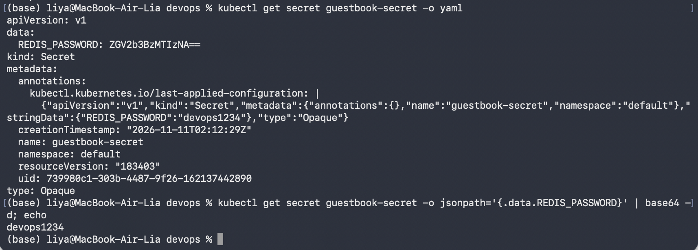
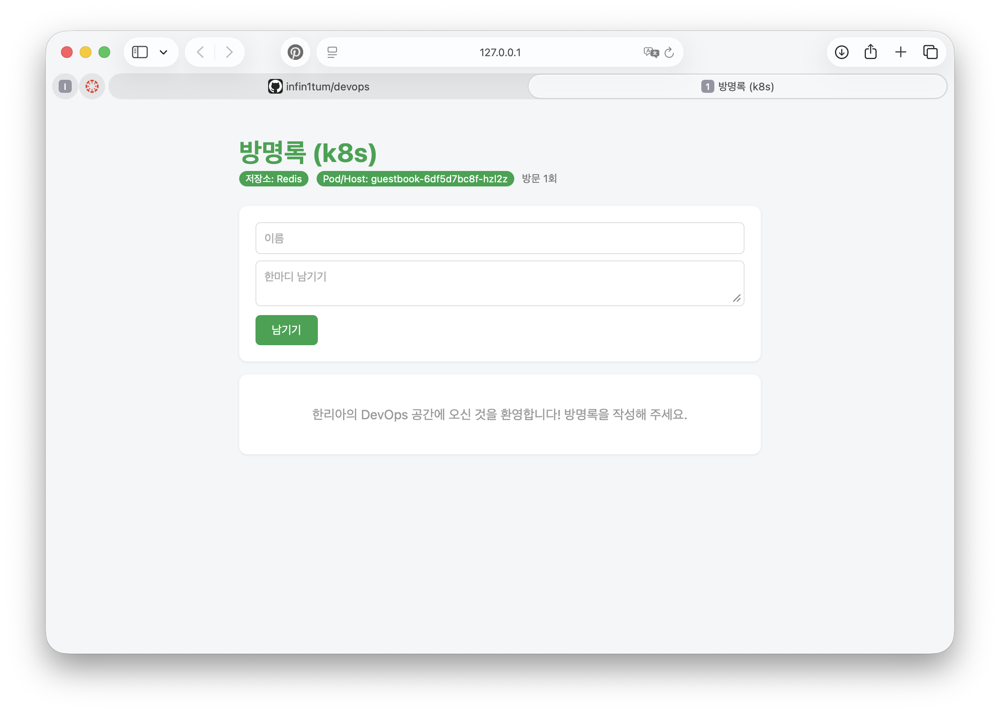
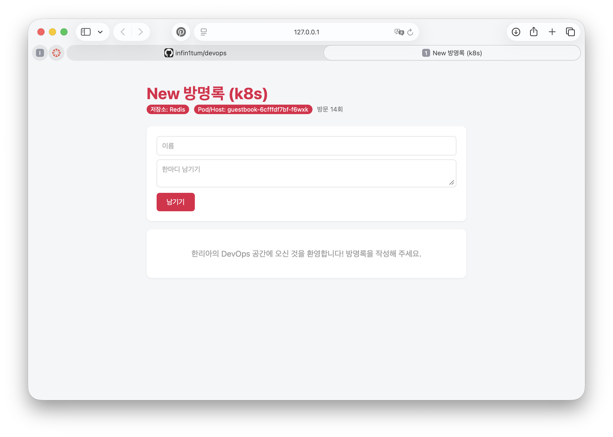
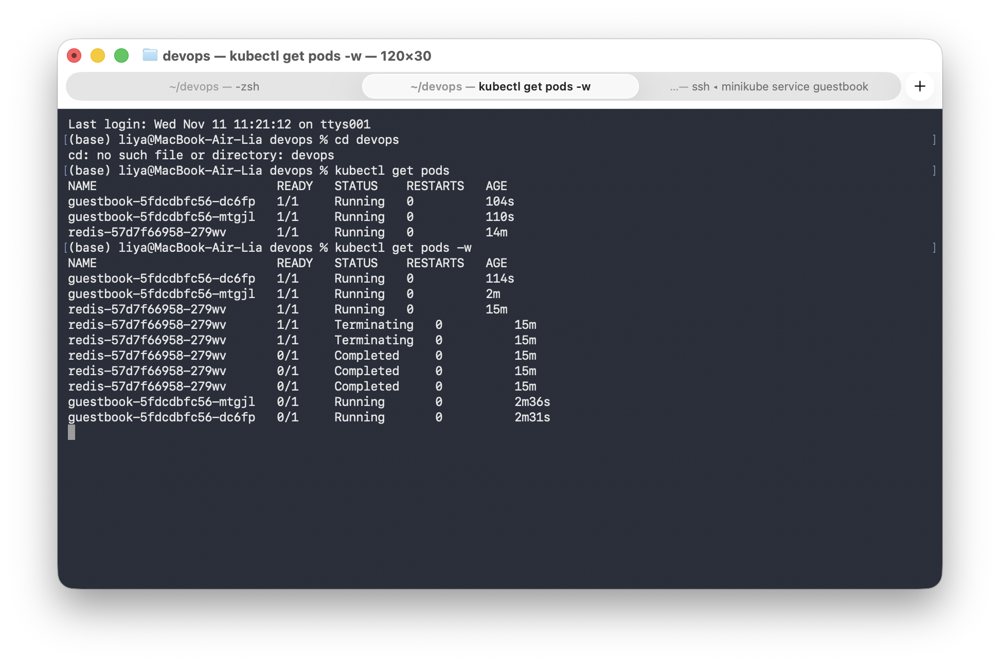
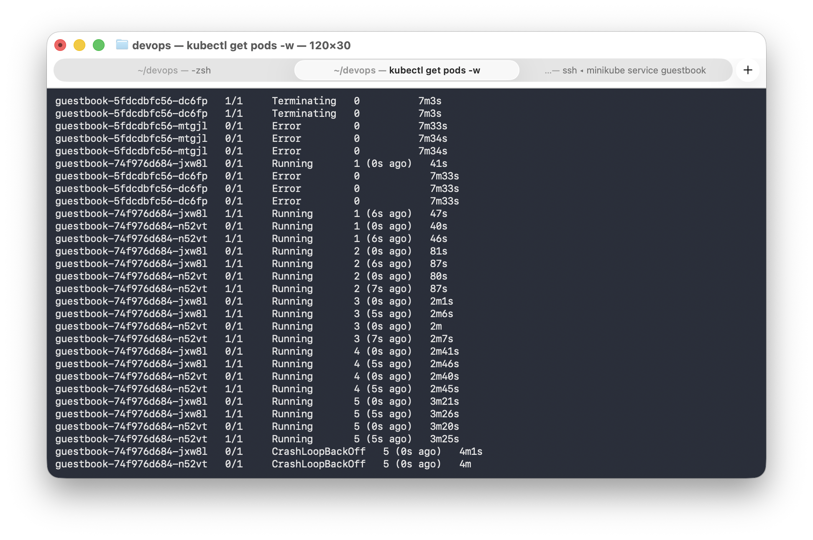

# 11주차 — 쿠버네티스 설정과 상태 점검

## 1. Secret 확인
`kubectl get secret guestbook-secret -o jsonpath='{.data.REDIS_PASSWORD}' | base64 -d`로 비밀번호가 그대로 읽혔습니다.

Secret의 값은 암호화가 아니라 base64 인코딩이라서 누구나 디코딩할 수 있습니다. 또한 `kubectl get secret -o yaml` 출력의 `last-applied-configuration` 주석에도 `stringData`의 비밀번호가 평문으로 남아 있어서, Secret을 쓰더라도 값이 노출될 수 있습니다. 그래서 `secret.yaml`은 Git에 올리지 않고 `.gitignore`에 넣었으며, 비밀번호를 `CHANGE_ME`로 바꾼 `secret.yaml.example`만 올렸습니다.

## 2. ConfigMap만 변경
ConfigMap의 `APP_TITLE`과 `THEME_COLOR`만 수정하고 `kubectl rollout restart`를 실행했습니다. 이미지를 다시 빌드하지 않았고 코드도 고치지 않았는데 제목과 색이 바뀌었습니다. 환경 변수는 Pod 시작 시점에 정해지므로 restart가 필요합니다. Redis를 사용하므로 방명록 글도 사라지지 않았습니다.

변경 전 (녹색, `방명록 (k8s)`):

변경 후 (붉은색, `New 방명록 (k8s)`):

처음에는 `THEME_COLOR`의 `#`를 빼먹어서 색이 적용되지 않았습니다(제목이 검은색, 배지와 버튼의 배경이 사라짐). `kubectl exec deploy/guestbook -- printenv THEME_COLOR`로 값을 확인하고 `"#e11d48"`로 고쳤습니다.

## 3. readiness 실패
Redis를 `replicas=0`으로 내리자 guestbook Pod가 Running이지만 READY 0/1이 되었습니다. `/readyz`가 503을 반환했고(`Readiness probe failed ... statuscode: 503`), 서비스가 해당 Pod로 트래픽을 보내지 않습니다. 재시작은 하지 않습니다. Redis를 다시 올리자 자동으로 복구되었습니다.

## 4. liveness 실패
liveness 경로를 일부러 `/devops`(없는 경로)로 바꾸자 `Liveness probe failed ... statuscode: 404`가 발생했고, kubelet이 컨테이너를 `will be restarted`로 계속 재시작해서 RESTARTS가 증가했으며 결국 CrashLoopBackOff가 되었습니다. 앱은 멀쩡한데 probe 경로가 틀려서 계속 재시작된 것입니다. `kubectl apply -f`로 원래 설정으로 복구했습니다.

## 5. 트러블슈팅 3단 루틴
1. `kubectl get pods`: STATUS, READY, RESTARTS로 어떤 상태인지 먼저 봅니다.
2. `kubectl describe pod <이름>`: 맨 아래 Events에 원인이 가장 많이 나옵니다.
3. `kubectl logs <이름>`: 앱 자체의 에러를 봅니다. CrashLoopBackOff면 `--previous`로 재시작 전 로그를 봅니다.

실습에서 ConfigMap 이름을 일부러 `guestbook-confg`로 틀렸더니 새 Pod가 `CreateContainerConfigError`가 되었습니다. describe의 Events에서 `configmap "guestbook-confg" not found`를 확인했고, `kubectl get cm`으로 실제 이름(`guestbook-config`)과 비교해서 고쳤습니다. 컨테이너가 시작되지 않았기 때문에 logs에는 볼 내용이 없었고, 기존 Pod 2개는 계속 Running이라서 서비스는 중단되지 않았습니다.

## 매니페스트
[k8s/](k8s/)
